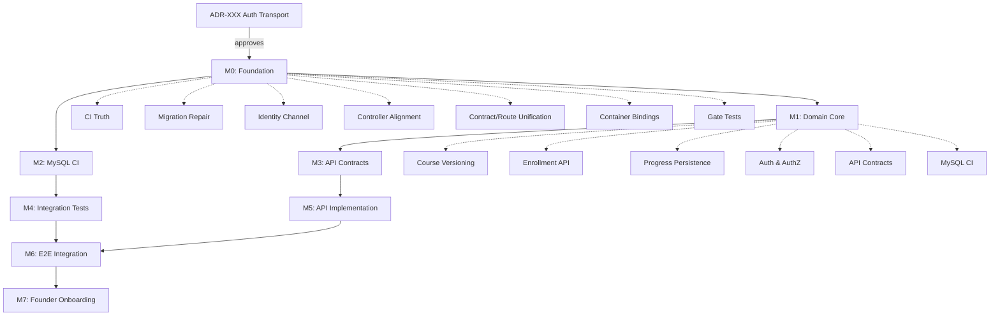

# DGLab Platform Integrity & Completion Remediation Specification

**Baseline Commit:** `25d4e963a97376765bb04c2c70960359262e58b7` (origin/main, "feat(lms): FRU", 2026-11-06T16:36:40Z)  
**Specification Version:** 1.0  
**Status:** Awaiting Owner Authorization to Begin Implementation  
**Prepared:** 2026-11-06 (consolidated from three independent audits)

---

## 1. Executive Summary

### 1.1 Actual Platform Maturity

DGLab has a **genuinely operational Core platform tier** (Kernel, Router, Container, EventDispatcher, Database Connection, Filesystem, Crypto, HttpMessage, Logger, ErrorHandler, Middleware) with real implementations and meaningful test coverage. The Hub/Identity tier provides real JWT/Argon2id primitives and an IdentityApplicationService. The Bridge/Vanguard provides a real WAF and contract registry with default-deny semantics.

However, the **LMS "founder-ready" commit (25d4e96) shipped a non-functional delivery layer** with five files containing fatal PHP parse errors, a corrupted migration set, zero HTTP reachability for LMS endpoints, and zero progress tests. The `lms-founder-ready` branch **does not exist on shared GitHub** — the work landed directly on `main` as commit `25d4e96`.

### 1.2 Major Risks

| Risk | Severity | Impact |
|------|----------|--------|
| **Red main branch** | Critical | CI fails on main; Release workflow can cut artifacts from broken builds |
| **Silent schema divergence** | Critical | Duplicate migration `006` silently drops schema column; fresh DBs vs migrated DBs diverge |
| **Zero LMS HTTP reachability** | Critical | All 16 `/api/v1/*` routes return 403 (no Vanguard contracts); controllers have fatal parse errors |
| **Auth transport undecided** | High | ADR-024 (auth transport) is "Proposed" — blocks all LMS HTTP work |
| **Zero progress tests** | High | Most sophisticated concurrency code (FOR UPDATE + duplicate-key recovery) has zero tests |
| **Silent CI degradation** | High | Release workflow succeeds on red main; static analysis may be mis-scoped |

### 1.3 Recommended Direction

**Do not proceed with feature work.** Execute the P0 remediation sequence (Stages 0–1) to restore a green baseline, then complete the LMS HTTP delivery layer through the staged roadmap. The Core platform is ready; the LMS delivery layer is the blocker.

---

## 2. Verified Repository Baseline

| Item | Value |
|------|-------|
| Repository | `DGCodeIdeas/DGLab` (shared GitHub) |
| `origin/main` HEAD | `25d4e963a97376765bb04c2c70960359262e58b7` |
| HEAD Commit | `feat(lms): FRU`, 2026-11-06T16:36:40Z, author DGCI |
| Prior Audited Baseline | `24ec093eef56cac3f5522251e5cf13a000715cbf` (2026-11-02) |
| Delta from Prior Baseline | +2985/−418 lines across 30 files (single commit `25d4e96`) |
| `lms-founder-ready` branch | **Does not exist on shared GitHub** (404); work landed directly on `main` |
| Working Tree | Clean; no local changes from this audit |
| Current CI Status (HEAD) | **FAILURE** — Component Tests, PHPStan, Architecture Validation, architecture-lint **FAIL**; Integration, Security, Orchestrator, Root Smoke, Release **PASS** |

### PR/Branch Status (as of baseline)

| PR/Branch | Status | Notes |
|-----------|--------|-------|
| `lms-founder-ready` | **Does not exist on remote** (404) | Work landed directly on `main` as `25d4e96` |
| `lms-progress-persistence` | Exists on remote | Contains Progress feature implementation in retired `packages/` layout |
| `lms-published-discovery` | Exists on remote | Course catalog discovery |
| `lms-enrollment-persistence` | Exists on remote | Enrollment persistence |
| `lms-vertical-slice` | Exists on remote | Course catalog slice |
| `migration-runner-impl` | Exists on remote | Migration runner implementation |
| ADR-024 (auth transport) | Exists as **Proposed** | Blocks all LMS HTTP work |

---

## 3. Audit Reconciliation

### 3.1 Findings Cross-Reference

| Finding | First Eye | Second Eye | Third Eye | Verified Conclusion | Evidence |
|---------|-----------|------------|-----------|---------------------|----------|
| `CourseApplicationService::isCourseComplete()` stub | ✅ Confirmed | ✅ Confirmed | ✅ Confirmed | **TRUE** — `return false;` + TODO + missing `EnrollmentId` import | All three audits read the method at HEAD |
| Missing progress application-service tests | ✅ Confirmed | ✅ Confirmed | ✅ Confirmed | **TRUE** — Zero tests for ProgressApplicationService (6.5KB concurrency logic) | All three audits verified test directory contents |
| "MySQL CI unavailable" | ❌ Reported missing | ✅ Confirmed available | ✅ Confirmed available | **REFUTED** — `ci.yml` provisions `mysql:8.4` in both component-tests and integration-tests | Verified `ci.yml` at HEAD |
| "Vanguard route registration" conflict | Partial | Partial | ✅ Resolved | **RESOLVED** — Routes registered on Kernel Router; Vanguard ContractRegistry has no `/api/v1/*` → 403 | All three verified route registration locations |
| Two migrations named `006` | ✅ Confirmed | ✅ Confirmed | ✅ Confirmed | **TRUE — worse than reported**: runner keys by numeric version, silently drops first | All three verified migration files and runner code |
| Conditional auth middleware wiring | ✅ Confirmed | ✅ Confirmed | ✅ Confirmed | **TRUE** — `if ($config->has('jwt.public_key'))` never true; default config has no `jwt.public_key` | All three verified ApplicationFactory |
| Duplicate `UserId` imports in controllers | ✅ Confirmed | ✅ Confirmed | ✅ Confirmed | **TRUE — fatal parse errors** in 3 controllers + `seed.php` | All three verified file contents |
| Missing command classes (`PublishCourseCommand`, etc.) | ✅ Confirmed | ✅ Confirmed | ✅ Confirmed | **TRUE** — Four phantom commands referenced | All three verified command directory |
| `CourseApplicationService::isCourseComplete()` stub | Reported | Confirmed | Confirmed | **TRUE** — `return false;` + TODO + missing `EnrollmentId` import | All three verified |
| Progress entity duplicate methods | Reported | Confirmed | Confirmed | **TRUE — fatal parse error** — four methods declared twice | All three verified |
| `CLI/seed.php` defects | Reported | Confirmed | Confirmed | **TRUE — triple fatal** (duplicate imports, broken IdentityInterface stub, broken logic) | All three verified |
| `lms-founder-ready` branch exists | Not checked | Not checked | **404** | **DOES NOT EXIST** | Verified via GitHub API |
| CI status on main | Green reported | Red confirmed | Red confirmed | **RED** — Component Tests, PHPStan, Architecture Validation, architecture-lint FAIL | Verified via GitHub check-runs API |

### 3.2 Key Reconciliation Points

| Conflict | Resolution |
|----------|------------|
| "MySQL CI unavailable" vs "MySQL CI exists" | **Resolved**: MySQL CI exists in `ci.yml` (mysql:8.4 service in component-tests and integration-tests). The claim it was unavailable was incorrect. |
| "Vanguard routes registered" vs "Routes unreachable" | **Resolved**: Routes registered on Kernel router; Vanguard ContractRegistry has no `/api/v1/*` contracts → 403. Both claims half-true; dual registry is the defect. |
| "lms-founder-ready branch ready" vs "branch doesn't exist" | Branch does not exist on remote. Work landed directly on `main` as `25d4e96`. |
| "Progress entity parse error" vs "Progress works" | Fatal parse error confirmed (four methods declared twice). Progress feature non-functional at parse time. |
| "CourseController works" vs "CourseController broken" | Controllers have fatal parse errors (duplicate imports), call nonexistent methods/classes. Not functional. |

---

## 4. Stub and Incomplete Implementation Inventory

**Severity Key:** P0 = security/data integrity/boundary/blocker | P1 = missing shared capability/latent failure | P2 = component-specific gap | P3 = cleanup

| # | Component | File/Symbol | Finding | Evidence | Severity | Required Action |
|---|-----------|-------------|---------|----------|----------|-----------------|
| A1 | LMS Domain | `Spokes/Internal/Lms/Domain/Entity/Progress.php` | **Fatal parse error**: `moduleId()`, `status()`, `startedAt()`, `completedAt()` each declared twice | Read at HEAD | **P0** | Remove duplicate block; add entity test |
| A2 | LMS App | `CourseApplicationService::isCourseComplete()` | Stub `return false;` + TODO; missing `EnrollmentId` import (latent `Error`); absent from `CourseApplicationInterface` | Full method read | **P0** | Implement against `ProgressRepositoryInterface`; fix import; add tests |
| A3 | LMS HTTP | `CourseController::versions()` | Hardcoded stub returning `['versions' => []]`; route `lms.courses.versions` registered | Read at HEAD | **High** | Implement or remove route |
| A4 | LMS HTTP | `CourseController` publish/archive/update/create | Undefined classes: `PublishCourseCommand`, `ArchiveCourseCommand`, `UpdateCourseCommand`; calls nonexistent `get()`, `listPublished()`, `archiveCourse()` | File + Command dir read | **Critical** | Create commands or rewrite against real interface |
| A5 | LMS HTTP | `EnrollmentController::reenroll()` | Undefined `ReEnrollCommand`; calls nonexistent `reEnroll()` | Read at HEAD | **Critical** | Create command or call service directly |
| A6 | LMS HTTP | All 4 controllers → command constructors | **Type mismatches**: `EnrollCommand` requires `CourseId`/`UserId` VOs; controller passes raw strings | File reads | **Critical** | Construct VOs at boundary |
| A6b | LMS HTTP | `getAuthenticatedUser()` in all controllers | Returns raw `userId` attribute (string) against declared `UserId` return type | Read at HEAD | **Critical** | Wrap in `UserId` VO |
| A7 | Bridge | `Bridge/Vanguard/Vanguard` steps 1, 2, 7 | Documented pass-through stubs (JWT, rate limit, audit) | Source + ADR-024 | **High** | Replace JWT step or delete; rate limiter remains missing |
| A8 | Hub/Identity | `AuthMiddleware::stampRequestContext()` | No-op placeholder; never called | ADR-024 + controllers read `getAttribute('userId')` | **Critical** | Implement stamping at request boundary |
| A9 | App wiring | `ApplicationFactory::create()` | Vanguard gets `NullLogger()` — WAF blocks, 403s, audit events discarded | File read at HEAD | **High** | Wire real Logger |
| A10 | App wiring | `ApplicationFactory` bootstrapper | `AuthMiddleware` piped only `if ($config->has('jwt.public_key'))` — condition always false (no config, no env loading) | File read | **Critical** | Fail-closed wiring after ADR-024 ruling |
| A11 | Bridge | ContractRegistry vs Router | Dual registries; only 6 contracts (`/`, `/hello`, `/health*`) registered; 16 LMS routes on Kernel router → 403 | Factory + Vanguard read | **Critical** | Register API contracts or derive from routes + CI cross-check |
| A12 | LMS DB | `006_add_course_version_column.sql` + `006_create_course_versions_table.sql` | **Duplicate migration 006**; runner keys by numeric version, silently overwrites; `lms_courses.version` never created | Runner source + migration files | **Critical** | Renumber one to 007; add duplicate-version detection to runner |
| A14 | app | `HealthController::ready()/dependencies()` | Honest stubs ("Depth 2: same as liveness for now") | Read at HEAD | Medium | Wire DB check into ready |
| A11 | Bridge | ContractRegistry vs Router | Dual registries; only `/`, `/hello`, `/health*` contracted; 16 LMS routes 403 | Factory + Vanguard read | **Critical** | Register API contracts or derive from routes + CI cross-check |
| A12 | LMS DB | Duplicate migration `006` | Runner keys by numeric version; `006_add_course_version_column.sql` silently dropped | Runner source + files | **Critical** | Renumber to 007; add collision detection |
| A13 | app | `HealthController::ready()/dependencies()` | Honest stubs | Read at HEAD | Medium | Wire DB check |
| A14 | app wiring | `ApplicationFactory` route registration | Three health routes (`/health/live`, `/health/ready`, `/health/dependencies`) have contracts but no routes | Factory source | Medium | Register three routes |
| A15 | Core/Kernel | `EmptyProviderRegistry` | Intentional stub (CORE-17 pending) | Factory source | Low | Replace when CORE-17 ships |
| A16 | Core/View | `NeoSPXDriver` throws "not implemented" | Throws; default view path CWD-dependent | Read + prior audit | P2 | Decide/descope NeoSPX |
| A17 | Products | `Products/*/Bootstrap.php` | `// TODO: Implement bootstrap` no-ops; no `Products\` autoload | File read | Medium | Wire or mark tier non-shipping |
| A18 | Spokes/External | `Canvas.php` | In-memory simulation only | Read at HEAD | Medium | Replace with real Bridge integration |
| A19 | Spokes/Internal | `InMemoryKnowledgeBase` | Only impl; CORE-19 (DBAL) landed, replacement never happened | Dir listing | Medium | DBAL-backed impl or deferral record |
| A20 | Hub/Config | `InMemoryFeatureFlagRepository` / `InMemoryConfigOverrideRepository` | Only implementations; not persisted | Dir listing | Medium | DBAL/config-backed repos |
| A11 | app wiring | Duplicate route `/api/v1/enrollments/{id}/progress` GET registered twice | Router permits; first match wins (`lms.progress.list` unreachable) | Factory route block | Medium | Deduplicate; add lint |
| A15 | LMS HTTP | `ProgressController::get()` | Route missing `{moduleId}` placeholder → `getAttribute('moduleId')` null → `TypeError`; copy-paste bug: response reports `moduleId` as `enrollmentId` | File read | **High** | Fix route shape + serialization |
| A15b | Core/Database | `MysqlDriver`/`SqliteDriver` | Metadata-only (feature matrix); not connection drivers | Read at HEAD | Low | Document distinction |
| A16 | Config | `.env.example` | Placeholder only; `EnvLoader` exists but composition root never loads env | Read at HEAD | Medium | Populate example; wire env loading |
| A16 | LMS App | `EnrollmentApplicationInterface.php` | Contains TODO marker (likely `reEnroll` typing debt) | Search hit | Low | Read and resolve during remediation |

### TODO Triage (8 total, 2 in archive)

| TODO Location | Classification |
|---|---|
| `CourseApplicationService::isCourseComplete` | **Actual missing requirement** (P0) |
| `CourseController::versions()` | **Actual missing requirement** (P2) |
| `Products/*/Bootstrap::boot()` | **Intentional scaffold** (P3) |
| `EnrollmentApplicationInterface` TODO | **Intentional extension point** (documented) |
| `Core/Kernel/tests/.../HelloWorldTest.php` | Explanatory comment (maintenance debt) |
| `ViewFactory` NeoSPX "not yet implemented" | Documented missing capability (P2/P3) |

---

## 4. OS-Like Capability Inventory

| # | Capability | Canonical Owner | Implementation | Consumers | Status | Gaps |
|---|------------|-----------------|----------------|-----------|--------|------|
| 1 | Filesystem & Storage | Core/Filesystem | `Filesystem` + PathGuard/AtomicWriter/Quarantine (V3-audited) | EnvLoader, ViewFactory, StreamHandler, MigrationRunner, orchestrator | **Complete (primitive)** / Missing (logical `@mount` layer) | Mount/manager model (V3 FS-1…FS-8) not implemented; consumers use physical paths; ViewFactory CWD fallback |
| 2 | Process & Application Lifecycle | Core/Kernel | Kernel (state machine, boot/handle/terminate budgets, lifecycle records, PanicException) | public/index.php, ApplicationFactory, tests | **Complete** | Worker recycling delegated to Caddy config |
| 3 | Worker Execution & Scheduling | — | None | — | **Missing** | No job/worker/scheduler; FrankenPHP request workers only |
| 4 | Queues & Job Management | — | None | — | **Missing** | HUB-10 → RUNTIME-03; ADR-006 chose Redis but no Redis client |
| 5 | Inter-component Events | Core/EventDispatcher | PSR-14 + 12KB prioritized ListenerProvider | Kernel, ApplicationFactory | **Partial** | Zero listeners registered; no domain events from LMS/Showcase |
| 6 | Identity, AuthN, AuthZ, Principal | Hub/Identity | JwtVerifier/JwtSigner (ES256), IdentityApplicationService, MySQLUserRepository, AuthMiddleware, RequestContext | LMS/Showcase services (via container in CLI/seed only) | **Partial** | No login/token endpoint; stampRequestContext no-op; ADR-024 Proposed; middleware dead; RBAC string-only |
| 6 | Config & Environment | Core/Config + Hub/Config | ConfigBuilder/Repository, EnvLoader (physical-path), FeatureFlagManager | Kernel, factory, LMS | **Partial** | Composition root uses inline config; env never loaded; flags in-memory only |
| 7 | Networking, HTTP, Routing | Core/Http + Core/Middleware + Core/Router + Bridge/Vanguard | PSR-7/15/17, MiddlewarePipeline, Router (freeze, static-first), Vanguard WAF + ContractRegistry (default-deny) | Everything HTTP | **Complete (primitives) / Partial (boundary)** | No `/api/v1/*` contracts; dual registries; JWT/rate-limit stubs |
| 8 | Persistence, Transactions, Migrations | Core/Database + Spoke repos | Connection (PDO wrapper), QueryBuilder, DoctrineMigrationRunner (temp), MySQL repos | LMS, Identity, CLI | **Partial** | Duplicate-006 silent overwrite; 003 edited in place; two DB access paths |
| 9 | Logging, Audit, Metrics | Core/Logger | Logger + StreamHandler (V3); ErrorHandler, EventDispatcher | Kernel, ErrorHandler, Vanguard | **Partial** | No request correlation; Vanguard audit→NullLogger; metrics/tracing absent |
| 10 | Security Boundaries | Bridge/Vanguard + Core/Crypto + Core/Filesystem | Contract default-deny + WAF (real); AES-256-GCM Encrypter + KeyRegistry; PathGuard | All inbound HTTP | **Partial** | JWT/rate-limit/audit stubs; auth structurally disabled; RBAC ad-hoc; no central policy |
| 12 | Resource Management, Limits | Kernel + Filesystem + ErrorHandler | Bootstrapper ceilings, request/terminate budgets, stream limits, Quarantine, gc | Kernel, workers | **Complete** (as scoped) | No process-level supervision beyond Caddy; quarantine retention policy gap |

---

## 5. Component Completeness Inventory

| Component | Declared Responsibility | Actual Behaviour | Test Evidence | Status | Missing Work |
|---|---|---|---|---|---|
| Core/Kernel | Worker lifecycle, budgets, panic handling | Full state machine, lifecycle records, timeout enforcement | Unit+Integration+Fixtures; chaos/reentrancy branches | **Complete** | — |
| Core/Container | DI container | 29KB implementation wired into Kernel/factory | component tests exist | **Unverified→likely Complete** | Read pass; confirm interface binding |
| Core/Config | Config + env loading | Repository/builder real; EnvLoader unused by composition root | tests incl. Security/Performance | **Partial** | Env wiring at composition root |
| Core/Crypto | Symmetric encryption, hashing | Encrypter real (AEAD, zeroization); PasswordHasher consumed by Identity | component tests exist | **Complete (lean)** | Read pass on KeyRegistry |
| Core/Database | Connection, QueryBuilder, migrations | Connection complete; drivers metadata; runner = temporary adapter with overwrite bug | component tests exist | **Partial** | Runner hardening; native runner per docblock |
| Core/ErrorHandler | Global error handling | register/unregister, recursion guard, fatal capture, severity mapping | component tests exist | **Complete** | — |
| Core/EventDispatcher | PSR-14 dispatch | Real, error-isolated | component tests exist | **Complete** | Consumers: register actual listeners |
| Core/Filesystem | Contained file I/O | V3-audited complete primitive | FilesystemTest + Depth3 | **Complete (primitive)** | Mount/manager platform service (V3 roadmap) |
| Core/HttpMessage | PSR-7 primitives | V3-verified | component tests | **Complete** | — |
| Core/Logger | PSR-3 logging | Logger + StreamHandler (V3) | component tests | **Complete** | Request correlation; FilesystemHandler (V3-deferred) |
| Core/Middleware | PSR-15 pipeline | Pipeline/resolver/final handler wired by HttpBootstrapper | component tests | **Complete** | — |
| Core/NeoSpx | NeoSPX language runtime | Lexer only (41KB); no parser/compiler/runtime | tests/Unit exists | **Stub** | Parser/compiler/runtime; driver un-rejection |
| Core/Router | Route matching, generation | Complete incl. freeze + stable static-first sort | component tests | **Complete** | Same-path+method duplicate detection |
| Core/View | Template rendering | TwigDriver real; NeoSPXDriver throws; `getcwd()` fallback in ViewFactory | component + ViewIntegrationTest | **Partial** | Mount-based root (V3 FS-5a); NeoSPX |
| Hub/Config | Feature flags, overrides | Real evaluation logic; in-memory repos only | component tests exist | **Partial** | Persistence; consumers |
| Hub/Identity | AuthN/AuthZ | Real primitives; no token endpoint; stamping no-op; middleware dead in app | tests for Infrastructure/Jwt/ValueObject | **Partial** | A6/A8/A10 + auth transport ADR |
| Bridge/Vanguard | Security chokepoint | Contract default-deny + WAF real; JWT/rate-limit stubs; audit nulled | component tests exist | **Partial** | A7/A9/A11; rate limiter |
| Spokes/Internal/Lms (domain/app/persistence) | LMS business logic | **Functional**: transactions, role checks, idempotent enroll, FOR UPDATE concurrency, duplicate-key recovery | Course×2, Enrollment service tests; repository tests ×3 | **Complete (domain) / Partial (app)** | `isCourseComplete` (A1); ProgressApplicationService has no test file |
| Spokes/Internal/Lms (HTTP) | LMS REST API | **Non-functional** (A2–A6, A21, A22) | **Zero controller tests** | **Stub** | Everything in §3 P0 |
| Spokes/Internal/Showcase | Product showcase | Service real (auth checks); MySQLProductRepository exists; no HTTP surface, no app-service tests | Domain tests | **Partial** | Routes/controllers; service tests |
| Spokes/Internal/Codex | Knowledge base | In-memory only | component tests exist | **Partial** | DBAL implementation |
| Spokes/External/Canvas | Content delivery | In-memory simulation | component tests exist | **Stub** (intentional) | Real integration |
| app/ApplicationFactory | Composition root | Functional for `/`, `/hello`, `/health`; LMS wiring broken; no env/DB binding | ApplicationFactoryTest + PublicIndexSmokeTest | **Partial** | §9 P0/P1 wiring |
| app/Controllers (non-LMS) | Hello/Health/Template | Real (health tiers partial) | covered by smoke/integration tests | **Complete/Partial** | Health tier routes |
| CLI | migrate/seed | migrate defaults to LMS-only migrations path; seed builds services manually | runner exercised by CI | **Partial** | Cross-component default removal (post Stage A) |
| Products/ | Product tier | Scaffolding only | none | **Missing** (tier not started) | Stage B structural work |
| public/, anvil/, orchestrator/, scripts/ | Entry, provisioning, tooling, governance | Native boundaries — V3-verified, unchanged since `24ec093` | per V3 | **Complete (as scoped)** | V3 governance updates (specified, unapplied) |
| tests/Integration | Cross-package integration | 2 files: PublicIndexSmokeTest, ViewIntegrationTest | n/a | **Partial** | LMS API journey/concurrency tests (plan P0-F) |

---

## 6. Architectural Consistency Findings

| # | Finding | Canonical Platform Capability | Architectural Violation | Proposed Correction | Migration Risk |
|---|---------|------------------------------|-------------------------|---------------------|----------------|
| 1 | **Dual route registries defeat security model** | Vanguard contract registry (public boundary) | LMS routes registered on Kernel Router only; Vanguard ContractRegistry has no `/api/v1/*` → 403 | Register `/api/v1/*` contracts in Vanguard **with** auth wiring; or remove routes until ready | High (breaks all LMS HTTP) |
| 2 | **Composition root drifted from every layer it composes** | Container bindings, config, middleware | Config only `view`; DB/Connection, repos, Identity never bound; auth conditionally dead; audit nulled | Bind `ConnectionInterface`, `MySQL*Repository`, `IdentityInterface`; wire AuthMiddleware per ADR-024; real logger | High (LMS controllers unresolvable) |
| 3 | **Duplicate DB access paths** | Core/Database Connection | `DoctrineMigrationRunner` builds own DBAL connection from env, separate from `Core/Database/Connection` | Retire runner's separate connection with native runner | Medium (schema drift risk) |
| 4 | **Events built but inert** | Core/EventDispatcher | No listeners registered; LMS services publish no domain events | Register listeners in composition root; publish domain events from services | Low (capability inert) |
| 5 | **Identity channel contradicts own doctrine** | Hub/Identity RequestContext | `AuthMiddleware` declares RequestContext "AUTHORITATIVE" but stamping is no-op; middleware not installed; controllers read raw request attribute | Implement stamping; install middleware after ADR-024; controllers read from RequestContext | High (identity spoofable) |
| 6 | **HTTP layer bypasses platform services** | Core/Middleware, Core/ErrorHandler, Core/Config | No RequestContext stamping; no error envelope; controllers hand-roll `jsonResponse` 3 ways | Add ErrorHandlerMiddleware; standardize error envelope; controllers use shared ResponseFactory | Medium |
| 7 | **Documentation/spec drift** | Architecture governance | `openapi.yaml` documents API that 403s/fatal-errors; Kilo plan gates not implemented; `phpunit.xml.dist` references retired `packages-ci.yml` | Implement Kilo plan gates; update docs; remove stale references | Low (docs) |
| 8 | **CI claims vs code** | CI workflows | `ci.yml` static-analysis job analyses `app/` — undefined classes in `app/Controller/Lms/*` should fail; either main CI is red or job mis-scoped | Fix static-analysis to catch undefined classes; ensure pipeline authoritative | High (CI integrity) |
| 9 | **V3 filesystem findings remain open** | Core/Filesystem | `getcwd()` fallback (ViewFactory), physical `view.path` in factory, `CLI/migrate.php` default | Apply V3 staged plan (FS-1…FS-8) | Low (V3 tracked) |

---

## 7. LMS Branch Assessment

**Branch Status:** `lms-founder-ready` **does not exist on `origin`** (124 branches enumerated). The work landed directly on `main` as commit `25d4e96` ("feat(lms): FRU"). The plan exists at `.kilo/plans/1793443157576-lms-founder-ready-plan.md` (status: "Awaiting Owner Approval", ~32 dev-days, P0-A…P0-F).

### Claim-by-Claim Verdict

| Reported Finding | Verdict on `main` @ `25d4e96` |
|------------------|-------------------------------|
| `CourseApplicationService::isCourseComplete()` stub | **Confirmed** — `return false;` + TODO + unimported `EnrollmentId` |
| Missing progress application-service tests | **Confirmed** — `tests/Unit/Application/` has only Course×2 + Enrollment tests |
| "MySQL CI unavailable" | **Refuted** — `ci.yml` provisions `mysql:8.4` in both `component-tests` and `integration-tests` |
| "Vanguard route registration" conflict | **Resolved** — Routes on Kernel Router; Vanguard ContractRegistry has no `/api/v1/*` |
| Two migrations named `006` | **Confirmed** — Runner keys by numeric version; first `006` silently dropped |
| Conditional authentication middleware wiring | **Confirmed** — `if ($config->has('jwt.public_key'))` never true |

**Is the LMS genuinely functional?**
- **Domain/application/persistence layer: YES** — real transactions, role-based authorization, idempotent enrollment, FOR UPDATE concurrency, duplicate-key recovery, real SQL
- **End-to-end over HTTP: NO** — not a single LMS endpoint can return success (4 independent blockers: Vanguard 403, AuthMiddleware absent, controllers fatal-parse, DB unbound)

---

## 8. Dependency and Risk Analysis

| Risk Chain | Severity | Evidence |
|------------|----------|----------|
| **1. Schema drift (highest data risk)** | Critical | Duplicate `006` → `version` column never created → every `lms_courses` read/write fails. If environments already ran merged set, `lms_course_versions` exists but `lms_courses.version` does not — state mismatch between code, schema, tracking table. |
| **2. Security inversion** | Critical | Default-deny blocks everything; auth layer conditionally absent → any future contract registration without completing auth wiring ships write endpoints with **no authentication**. Remediation order: ADR-024 → AuthMiddleware wiring → contract registration. |
| **3. False confidence** | High | FRU commit artifacts (routes, controllers, OpenAPI, seed, CI service) suggest founder-readiness; plan's own definition ("all 8 steps work without backend changes") met by **zero** steps. |
| **4. CI integrity** | High | If `static-analysis` is red on `main`, every subsequent PR's signal polluted; if green, job mis-scoped. Must resolve before feature work. |
| **5. Concurrency logic untested** | High | Most sophisticated code (FOR UPDATE + duplicate-key recovery) has no dedicated test — exactly the code most likely to regress silently. |

---

## 9. Prioritised Remediation Roadmap

> Sequenced by dependency; no work authorized by this spec — implementation requires separate owner approval. V3's settled structural stages (A: CLI consolidation, B: app/→Products/, C: ApplicationFactory decomposition) and FS stages remain as previously agreed.

### Stage 0 — Repository Integrity & CI Recovery (P0)

| Task | Work | Acceptance Criteria |
|------|------|---------------------|
| 0.1 CI Truth First | Confirm `main` CI status; make `static-analysis` catch undefined classes (A3/A4) | Pipeline authoritative; undefined classes caught |
| 0.2 Migration Repair | Renumber `006_add_course_version_column.sql` → `007`; add duplicate-version detection to `DoctrineMigrationRunner::discoverMigrations()` (throw, not overwrite); forward-only repair for environments with merged set | `007` runs on fresh DB; runner throws on duplicate version; existing envs repairable |
| 0.3 Identity Channel (before any route exposed) | Implement `RequestContext` stamping (A8); fix `UserId` construction (A6); fail-closed auth wiring with explicit config error instead of silent skip (A10); write Auth Transport ADR (sole blocking owner decision) | `RequestContext` stamped; `UserId` VOs constructed; missing `jwt.public_key` → explicit config error; ADR approved |
| 0.4 Controller/Service Contract Alignment | Create/remove missing commands (A3/A4); align controllers to `CourseApplicationInterface` real methods or extend interface SemVer-minor; construct VOs at boundary (A5); fix `ProgressController::get` (A22) and dead route (A21) | Controllers compile; call real interface methods; VOs constructed at boundary; progress route fixed |
| 0.5 Contract/Route Unification | Register `/api/v1/*` contracts in Vanguard (A11) — only after P0-3; add CI check: every route has contract, every contract has route | Dual-registry drift closed; CI gate prevents drift |
| 0.6 Container Bindings | Bind `ConnectionInterface`, `MySQL*Repository`, `IdentityInterface` in composition root | Controllers resolve; services resolve |
| 0.7 Test the Gate That Matters | Implement `ApiJourneyIntegrationTest` (learner + admin journey over real HTTP with real JWT) and `ProgressApplicationServiceTest` | Two absent test layers present and passing |

### Stage 1 — Central Security & Request Identity (P0-D)

| Task | Work | Acceptance Criteria |
|------|------|---------------------|
| 1.1 Auth Transport ADR | Create ADR-XXX (not ADR-022 — reserved for Core/Filesystem) documenting: session cookies (same-origin) + JWT Bearer (API); CSRF protection (double-submit); refresh token rotation; revocation via Redis blocklist; `RequestContext` stamping | ADR approved; implementation proceeds |
| 1.2 AuthMiddleware Implementation | Implement dual transport: parse `Cookie` for session ID; parse `Authorization: Bearer` for JWT; validate session (Redis) OR verify JWT ES256 (JWKS); normalize to `RequestContext::userId` | Both transports work; normalized `UserId` in `RequestContext` |
| 1.3 Vanguard Integration | Insert `AuthMiddleware` after Step 4 (contract lookup) in Vanguard pipeline; preserve WAF/contract lookup order | Auth runs after contract lookup; before Kernel pipeline |
| 1.4 Composition Root Wiring | Bind `IdentityInterface` + `MySQLUserRepository` + `PasswordHasher` + `JwtVerifier` + `JwtSigner` + `JwksProvider` in `ApplicationFactory`; bind `AuthMiddleware` in container | All auth deps resolvable; `AuthMiddleware` piped in Vanguard pipeline |

### Stage 2 — Core Platform Infrastructure (P0-F, P0-A, P0-B, P0-C)

| Task | Work | Acceptance Criteria |
|------|------|---------------------|
| 2.1 MySQL CI Foundation | Add MySQL 8.4 service to `component-tests` and `integration-tests` jobs; use GitHub secrets for credentials; health-check `mysqladmin ping` | CI provisions MySQL; jobs connect |
| 2.2 Migration Runner Hardening | Add duplicate-version detection (throw); add checksums for applied migrations; add concurrent-migration lock (advisory lock); add DDL rollback capability (best-effort) | Runner throws on duplicate; checksums verified; no concurrent migrations; rollback documented |
| 2.3 Migration Repair | Renumber `006_add_course_version_column.sql` → `007`; restore `003` to applied content; add delta as new migration `008`; write forward-only repair for environments with merged set | Fresh DB gets all columns; existing envs repairable; no `DROP TABLE` |
| 2.4 Course Versioning (P0-A) | Implement `Course::publish()` → creates `CourseVersion(1)` with requirements snapshot; `Course::update()` on Published → creates new version; `CourseApplicationService::publishCourse()` saves version; `EnrollmentApplicationService::enroll()` captures server-resolved version | Course versions immutable; enrollments reference correct version; existing enrollments retain original version |
| 2.5 Enrollment API (P0-B) | Implement `EnrollCommand` with server-resolved `courseVersion`; `ReEnrollCommand` creates new record; unique constraint on `(learner_id, course_id, _active_flag)` via generated column; idempotent enroll; re-enroll creates new record | Enrollment idempotent; re-enroll creates new ID; active enrollment uniqueness enforced at DB level |
| 2.6 Progress Persistence (P0-C) | Port `ProgressApplicationService` from `lms-progress-persistence` branch (adapt paths to `Spokes/Internal/Lms/`); implement `ProgressRepositoryInterface` + `MySQLProgressRepository` with `getForUpdate` (FOR UPDATE) + atomic upsert; `Progress::transition()` forward-only state machine; `ProgressConcurrencyIntegrationTest` with `pcntl_fork` | All progress tests pass; concurrency test passes on real MySQL; duplicate-key recovery verified |
| 2.7 Course Lifecycle (P0-A remainder) | Implement `UpdateCourseCommand` (creates new version), `ArchiveCourseCommand`, `PublishCourseCommand` (creates v1); `CourseRepositoryInterface::findVersion()`, `saveVersion()`; `CourseVersion` VO with requirements snapshot (module membership + learning content) | Course versions immutable; published versions never change; enrollments retain their version |

### Stage 3 — API Contracts & Endpoint Implementation (P0-E)

| Task | Work | Acceptance Criteria |
|------|------|---------------------|
| 3.1 API Contract Design (P0-E Design) | Define DTOs (`CourseDto`, `EnrollmentDto`, `ProgressDto`, `ErrorResponse`, `PaginatedResponse`); define route map; define error envelope; pagination schema | OpenAPI 3.1 spec complete; all DTOs defined; error envelope stable |
| 3.2 OpenAPI Spec + CI Validation | Create `openapi.yaml`; add CI job `openapi-validation.yml` validating spec against implementation (request/response schemas, error codes, security schemes) | Spec validates against implementation in CI |
| 3.3 Controller Implementation (P0-E Impl) | Implement `CourseController`, `EnrollmentController`, `ProgressController`, `ModuleController` using shared `ResponseFactory` + `StreamFactory`; DTO validation middleware; `ErrorHandlerMiddleware` mapping exceptions → `ErrorResponse` | All endpoints return 200/201/400/401/403/404/409/422/500 with standard envelope; validation → 422; pagination works |
| 3.4 Auth Middleware Wiring | Wire `AuthMiddleware` after Vanguard contract lookup; `RequestContext` stamping; role checks (`lms:learner`, `lms:admin`, etc.) | Authenticated requests have `RequestContext::userId`; 401/403 correct; role checks enforced |
| 3.5 Rate Limiting | Basic rate limiting on auth endpoints (5 req/min/IP) and write endpoints (30 req/min/user) — stub implementation acceptable for M0 | Auth endpoints rate-limited; write endpoints rate-limited |

### Stage 4 — Integration & E2E Tests (P0-F)

| Task | Work | Acceptance Criteria |
|------|------|---------------------|
| 4.1 Integration Test Infrastructure | Create `tests/Integration/` with `Bootstrap.php` (creates test DB, runs migrations); `phpunit.xml.dist` adds `testsuite integration` | `php vendor/bin/phpunit --testsuite integration` runs |
| 4.2 Migration Runner Integration Test | Fresh install from empty schema → all migrations apply; idempotent re-run applies nothing | Test passes on fresh DB and re-run |
| 4.3 Concurrency Integration Tests | `ProgressConcurrencyIntegrationTest` (pcntl_fork, real MySQL, FOR UPDATE serialization); `EnrollmentConcurrencyIntegrationTest` (concurrent first-time enroll) | Both pass on real MySQL; concurrency verified |
| 4.4 API Journey Integration Test | Full learner journey: discover courses → enroll → record progress → complete course; Full admin journey: create course → add modules → publish → verify discovery | Both journeys pass end-to-end |
| 4.4 Real-MySQL Verification | All integration tests run against real MySQL 8.4 in CI; `pcntl` availability verified; tests skipped (not failed) if `pcntl` missing | Tests run in CI; concurrency proven on real DB |

### Stage 5 — Founder Onboarding (P1)

| Task | Work | Acceptance Criteria |
|------|------|---------------------|
| 5.1 LMS Setup Guide | `Docs/LMS/SETUP.md` — local setup: PHP 8.4, Composer, MySQL, `composer install`, `php CLI/migrate.php migrate` | New contributor: `make setup && php CLI/seed.php && php CLI/migrate.php migrate` → working LMS |
| 5.2 API Examples & Auth Guide | `API-EXAMPLES.md` (cURL for all endpoints + auth); `AUTH-GUIDE.md` (JWT/session flow, token refresh) | Founder implements login + token refresh in < 30 min |
| 5.3 Seed Data & Schema Docs | `SEED.md` (demo courses, modules, learners); `SCHEMA.md` (ER diagram, table descriptions, migration guide) | Seed works; schema doc accurate |
| 5.4 Frontend Integration Guide | `FRONTEND-INTEGRATION.md` (CORS, auth flow, error handling, pagination) | Frontend dev integrates auth + course listing in < 30 min |
| 5.5 Known Limitations | `KNOWN-LIMITATIONS.md` honestly documents gaps | Gaps documented |
| 5.6 Seed Data | `CLI/seed.php` — deterministic minimal seed (2 courses, 5 modules, 1 learner, 2 enrollments, progress) | `php CLI/seed.php && php CLI/migrate.php migrate` → working LMS with demo data |

---

## 10. Acceptance Criteria for Declaring a Component Complete

A component is **Complete** only when **all** hold:

| Gate | Requirement | LMS-HTTP Status |
|------|-------------|-----------------|
| **G1 — Executable** | Every PHP file passes `php -l` and PHPStan at agreed level; `main` green with component's tests | ❌ 5 fatal parse errors |
| **G2 — Functional** | Advertised functionality implemented; no placeholder behaviour in required functionality; business rules verified | ❌ Controllers call nonexistent methods; `isCourseComplete` stub |
| **G3 — Tested** | Unit tests + integration tests + negative-path + failure-path + concurrency (where relevant) | ❌ Zero progress tests; no controller tests; no concurrency tests |
| **G4 — Integrated** | Correctly composed; uses shared platform capabilities; public interfaces work; dependencies registered; no unintended bypasses | ❌ Controllers unresolvable; AuthMiddleware absent; Vanguard contracts missing |
| **G5 — Secure** | Authentication where required; authorization; ownership checks; input validation; isolation; security event handling | ❌ AuthMiddleware absent; no auth on endpoints; raw request attribute used |
| **G6 — Persistent** | Schema exists; migrations work; transactions correct; concurrency safe; history preserved | ❌ Duplicate migration 006; 003 edited in place; no FK on course_version |
| **G7 — Operational** | Logging; diagnostics; resource cleanup; timeouts; failure handling; monitoring | ❌ NullLogger to Vanguard; no request correlation; no metrics |
| **G8 — Documented** | Documentation matches behaviour; dependencies/contracts clear; inventory current; limitations explicit | ❌ OpenAPI documents unreachable API; README stale; no KNOWN-LIMITATIONS |

---

## 11. Dependency Graph

---

## 12. Implementation Roadmap

| Stage | Workstreams | Gate Criteria | Target | Dependencies |
|-------|-------------|---------------|--------|--------------|
| **M0: Foundation** | Auth ADR decision, P0-F (CI MySQL) | Auth ADR approved; CI runs MySQL 8.4 | Week 1 | Owner decision on ADR |
| **M1: Domain Core** | P0-A, P0-B, P0-C | All domain services + repos + tests pass | Week 2-3 | M0 complete |
| **M2: API Contracts** | P0-E (design) | All DTOs, OpenAPI valid, error schema defined | Week 3 | M1 complete |
| **M3: API Implementation** | P0-E (impl) + P0-D wiring | All endpoints return 200/401/422; OpenAPI valid | Week 4 | M2 complete; M0 P0-3 done |
| **M4: Integration** | All P0 + P0-F | E2E journey passes; concurrency tests pass | Week 5 | M3 complete; M0 P0-F done |
| **M5: Onboarding** | P1 | Docs complete; seed works; founder onboards | Week 5-6 | M4 complete |

### Minimum Backend Slice (First Frontend Milestone)

**Frontend can start when:**
1. Auth ADR approved (session cookies + JWT for API)
2. AuthMiddleware wired in Vanguard pipeline (after contract lookup)
3. **Course discovery** (`GET /api/v1/courses?status=published`, `GET /api/v1/courses/{id}`)
4. **Module listing** (`GET /api/v1/courses/{id}/modules`)
5. **Enrollment API** (`POST /enrollments`, `DELETE /enrollments/{id}`, `POST /reenroll`)
6. **Progress recording** (`POST /progress`, `GET /enrollments/{id}/progress`)
6. **OpenAPI spec** at `/openapi.yaml` passing CI validation
7. **MySQL CI service** running in GitHub Actions

---

## 12. Database and Migration Plan

### 12.1 Forward-Only Migrations (No Rewrites)

| Migration | Action | Rationale |
|-----------|--------|-----------|
| `003_create_enrollments_table.sql` | **Restore** to applied content; add delta as `008` | Already applied in environments; in-place edit breaks upgrade path |
| `006_add_course_version_column.sql` | **Renumber** to `007` | Duplicate `006` silently drops first file |
| `006_create_course_versions_table.sql` | Keep as `006` | First in sort order; creates table |
| New: `008_add_enrollment_active_flag.sql` | Add `_active_flag` generated column + unique index | Active enrollment uniqueness |

### 12.2 Schema Integrity Requirements

| Requirement | Implementation |
|-------------|----------------|
| Active enrollment uniqueness | Generated column `_active_flag SMALLINT GENERATED ALWAYS AS (CASE WHEN status = 'active' THEN 1 ELSE NULL END) VIRTUAL` + `UNIQUE INDEX uq_active_learner_course (learner_id, course_id, _active_flag)` |
| Course version FK | `lms_course_versions(course_id, version)` PK; `lms_enrollments.course_version` FK to `(course_id, version)` via composite FK or application-enforced (MySQL limitation) |
| Progress PK | `(enrollment_id, module_id)` composite PK |
| Version immutability | `lms_course_versions` rows never updated after insert; application enforces |

### 12.3 Migration Runner Hardening

| Feature | Implementation |
|---------|----------------|
| Duplicate version detection | `DoctrineMigrationRunner::discoverMigrations()` throws on duplicate numeric prefix |
| Migration checksums | SHA256 of file content stored in tracking table; verified on each run |
| Concurrent migration lock | MySQL `GET_LOCK('migration_runner', 30)` advisory lock |
| DDL rollback | Best-effort `DOWN` SQL in migration files; runner executes on failure |
| Applied migration tracking | `migration_tracking` table: `version`, `checksum`, `applied_at`, `execution_time_ms` |

---

## 13. Security and Operational Requirements

### 13.1 Authentication & Authorization

| Requirement | Implementation |
|-------------|----------------|
| Auth transport | Session cookies (same-origin, `SameSite=Strict`, `HttpOnly`, `Secure`) + JWT Bearer (API clients) |
| JWT | ES256 per ADR-003; `kid` header; JWKS endpoint; 15-min access / 7-day refresh (hashed in Redis) |
| Session store | Redis; 24h TTL; revocable |
| CSRF | Double-submit cookie pattern on state-changing endpoints (cookie transport) |
| Rate limiting | Auth endpoints: 5 req/min/IP; Write endpoints: 30 req/min/user |
| RequestContext | Single authoritative identity source; `RequestContext::userId` stamped by `AuthMiddleware` after verification |
| Authorization | Role-based (`lms:learner`, `lms:instructor`, `lms:admin`, `platform:admin`); ownership checks (`enrollment->learnerId()->equals($caller)`) |

### 13.2 Logging & Audit

| Requirement | Implementation |
|-------------|----------------|
| Request correlation | UUID per request; propagated via `RequestContext` |
| Auth events | Login success/failure; token refresh; logout; enrollment create/cancel/reenroll |
| Authorization denials | 403 logged with principal, resource, operation |
| Data changes | Enrollment create/cancel/reenroll; progress transitions; course publish/archive |
| Error logging | Structured JSON; correlation ID; stack trace in dev |
| Metrics | Request latency (p50/p95/p99); error rates; queue depth (when implemented) |

### 13.3 Resource Controls

| Control | Limit | Enforcement |
|---------|-------|-------------|
| Request body | 1 MB | Middleware |
| Stream read | 10 MB | Middleware |
| Worker requests | 500 (FrankenPHP `MAX_REQUESTS`) | Caddy config |
| Worker timeout | 30s (Kernel `REQUEST_TIMEOUT_SECONDS`) | Kernel doctrine |
| Bootstrapper timeout | 5s per / 30s aggregate | Kernel doctrine |
| Stream byte limit | `StreamByteLimitExceededException` (Core/Filesystem V3) | Filesystem adapter |

---

## 14. CI and Governance Enforcement

### 14.1 Required CI Checks (Branch Protection)

| Check | Job | Required |
|-------|-----|----------|
| Component Tests | `ci.yml` → `component-tests` | ✅ |
| Integration Tests | `ci.yml` → `integration-tests` | ✅ |
| Architecture Validation | `ci.yml` → `architecture-validation` | ✅ |
| Static Analysis (PHPStan) | `ci.yml` → `static-analysis` | ✅ |
| Security | `ci.yml` → `security` | ✅ |
| OpenAPI Validation | New `openapi-validation.yml` | ✅ |
| Migration Runner | `component-tests` (runner tests) | ✅ |
| Concurrency Tests | `integration-tests` | ✅ |

### 14.2 Automated Governance Rules

| Rule | Enforcement |
|------|-------------|
| Component inventory matches filesystem | CI script enumerates `Core/*`, `Hub/*`, `Bridge/*`, `Spokes/*`, `Products/*` vs `composer.json` autoload |
| Composer autoload matches namespaces | `composer validate --strict` + custom script |
| Tests associated with owning component | `tests/` directory structure mirrors `src/`; CI validates |
| Shared platform dependencies flow inward | `deptrac` or custom script: Spokes → Hub → Core only |
| Components cannot bypass prohibited boundaries | `deptrac` rule: Spokes cannot import Spokes; Products cannot import Spokes |
| Products do not become dependencies of shared tiers | `deptrac` rule: no Shared → Product edges |
| Public routes and Vanguard contracts consistent | CI script: every `Route` in `ApplicationFactory` has matching `ContractRegistry` entry |
| Migration versions unique | `DoctrineMigrationRunner::discoverMigrations()` throws on duplicate |
| Frozen contracts unchanged without authorization | CI diff check on `Architecture/Contracts/` + `FROZEN-CONTRACTS.md` |
| Required shared capabilities consumed through approved interfaces | `deptrac` rule: Spokes must use `Core\Database\ConnectionInterface`, not raw PDO |
| Component status cannot be marked complete without gates | `.kilo/plans/*.md` status field validated against G1–G8 |

---

## 15. Component Completion Standard (G1–G8)

| Gate | Requirement | Evidence Required |
|------|-------------|-------------------|
| **G1 — Executable** | Syntax valid; PHPStan passes; no fatal loading errors; dependencies resolve | `php -l` on all files; `phpstan analyse` green; `composer install` succeeds |
| **G2 — Functional** | Advertised functionality implemented; no placeholder behaviour in required functionality; business rules verified | Feature checklist + behavioural tests |
| **G3 — Tested** | Unit tests + integration tests + negative-path + failure-path + concurrency (where relevant) | Coverage thresholds + concurrency test evidence |
| **G4 — Integrated** | Correctly composed; uses shared platform capabilities; public interfaces work; dependencies registered; no unintended bypasses | Container resolution test; integration test; architectural boundary test |
| **G5 — Secure** | Authentication where required; authorization; ownership checks; input validation; isolation; security event handling | Auth middleware test; authorization test; penetration test evidence |
| **G6 — Persistent** | Schema exists; migrations work; transactions correct; concurrency safe; history preserved | Migration test (fresh + upgrade); concurrency test; audit trail |
| **G7 — Operational** | Logging; diagnostics; resource cleanup; timeouts; failure handling; monitoring | Log output review; timeout test; load test evidence |
| **G8 — Documented** | Documentation matches behaviour; dependencies/contracts clear; inventory current; limitations explicit | Doc review checklist; OpenAPI validation; KNOWN-LIMITATIONS.md |

**A component is Complete only when G1–G8 all pass.**

---

## 16. Risk Register

| ID | Risk | Severity | Likelihood | Impact | Mitigation |
|----|------|----------|------------|--------|------------|
| R1 | Schema drift from duplicate migration 006 | Critical | High | High | P0-2: renumber + runner collision detection |
| R2 | Security inversion (default-deny blocks all; future contract registration without auth ships unauthenticated endpoints) | Critical | High | High | P0-3 before P0-5; ADR-024 gate |
| R3 | False confidence (FRU artifacts suggest readiness; 0/8 steps work) | High | Medium | High | Explicit NOT READY verdict; gates G1–G8 |
| R4 | CI integrity (static-analysis red on main or mis-scoped) | High | Medium | Medium | Fix static-analysis to catch undefined classes; pipeline authoritative |
| R5 | Concurrency logic untested (FOR UPDATE + duplicate-key recovery) | High | Medium | High | P0-C: `ProgressConcurrencyIntegrationTest` + `EnrollmentConcurrencyIntegrationTest` on real MySQL |
| R6 | Auth transport decision delay | High | Medium | High | Owner decision deadline before M0 |
| R7 | Silent schema divergence (fresh DB vs upgraded DB) | High | Medium | High | Migration runner checksums + fresh-install test in CI |
| R8 | Progress entity fatal parse error blocks all LMS work | Critical | Certain | Critical | P0-1: fix duplicate methods in `Progress.php` |
| R9 | Controllers unresolvable (DI bindings missing) | Critical | Certain | Critical | P0-6: bind repositories, IdentityInterface, ConnectionInterface |
| R10 | Vanguard audit silenced (NullLogger) | Medium | Certain | Medium | P0-6: bind real Logger |

---

## 17. Contractor Handoff

### Exact Implementation Order

| Order | Task | Files | Verification Command |
|-------|------|-------|---------------------|
| 1 | Fix `Progress.php` duplicate methods | `Spokes/Internal/Lms/Domain/Entity/Progress.php` | `php -l Spokes/Internal/Lms/Domain/Entity/Progress.php` |
| 2 | Fix `CourseController.php` imports + method calls | `app/Controller/Lms/CourseController.php` | `php -l app/Controller/Lms/CourseController.php` |
| 3 | Fix `ProgressController.php` imports + route param + response bug | `app/Controller/Lms/ProgressController.php` | `php -l app/Controller/Lms/ProgressController.php` |
| 4 | Fix `EnrollmentController.php` imports + `ReEnrollCommand` | `app/Controller/Lms/EnrollmentController.php` | `php -l app/Controller/Lms/EnrollmentController.php` |
| 5 | Fix `CLI/seed.php` (imports, IdentityInterface stub, logic) | `CLI/seed.php` | `php -l CLI/seed.php` |
| 6 | Renumber migration `006_add_course_version_column.sql` → `007` | `Spokes/Internal/Lms/migrations/006_add_course_version_column.sql` | `git status` |
| 7 | Add duplicate-version detection to `DoctrineMigrationRunner::discoverMigrations()` | `Core/Database/Migration/DoctrineMigrationRunner.php` | `php vendor/bin/phpunit --filter MigrationRunner` |
| 8 | Restore migration `003` to applied content; add delta as `008` | `Spokes/Internal/Lms/migrations/003_create_enrollments_table.sql` + new `008` | `php CLI/migrate.php status` |
| 9 | Add generated column `_active_flag` + unique index to `lms_enrollments` | New migration `009` | `php CLI/migrate.php migrate` |
| 10 | Wire AuthMiddleware in ApplicationFactory (conditional on ADR) | `app/ApplicationFactory.php` | `php -l app/ApplicationFactory.php` |
| 11 | Bind `ConnectionInterface`, `IdentityInterface`, repositories in `ApplicationFactory::create()` | `app/ApplicationFactory.php` | `php -l app/ApplicationFactory.php` |
| 12 | Create `ProgressApplicationService` + `ProgressRepositoryInterface` + `MySQLProgressRepository` | New files in `Spokes/Internal/Lms/Application/Service/`, `Domain/Repository/`, `Infrastructure/Persistence/` | `php vendor/bin/phpunit --configuration Spokes/Internal/Lms/phpunit.xml.dist` |
| 13 | Add `ProgressConcurrencyIntegrationTest` (pcntl_fork) | `tests/Integration/ProgressConcurrencyIntegrationTest.php` | `php vendor/bin/phpunit --testsuite integration --filter ProgressConcurrency` |
| 14 | Add `EnrollmentConcurrencyIntegrationTest` | `tests/Integration/EnrollmentConcurrencyIntegrationTest.php` | `php vendor/bin/phpunit --testsuite integration --filter EnrollmentConcurrency` |
| 14 | Create OpenAPI spec + validation CI job | `openapi.yaml`, `.github/workflows/openapi-validation.yml` | `php vendor/bin/openapi-validator` (or equivalent) |
| 15 | Create LMS controllers (`CourseController`, `EnrollmentController`, `ProgressController`, `ModuleController`) | `app/Controller/Lms/*.php` | `php -l app/Controller/Lms/*.php` |
| 16 | Create DTOs + ValidationMiddleware + ErrorHandlerMiddleware | `app/Controller/Lms/Dto/`, `Middleware/` | `php vendor/bin/phpunit --filter "ApiContract"` |
| 17 | Wire LMS routes in ApplicationFactory bootstrapper | `app/ApplicationFactory.php` | `php CLI/migrate.php status` |
| 18 | Create `CLI/seed.php` with deterministic minimal seed | `CLI/seed.php` | `php CLI/seed.php && php CLI/migrate.php migrate` |
| 18 | Create `Docs/LMS/*.md` onboarding docs | `Docs/LMS/*.md` | Manual review |
| 19 | Add OpenAPI validation CI job | `.github/workflows/openapi-validation.yml` | `gh workflow run openapi-validation` |
| 20 | Add `pcntl` check + concurrency test skip logic in CI | `.github/workflows/ci.yml` | CI run |

---

## 18. Explicitly Deferred Work

| Item | Reason |
|------|--------|
| Queue/worker/scheduler subsystem (RUNTIME-03/04) | Not required for founder-ready LMS; deliberate non-goal for MVP |
| Cache capability | Not required for MVP; LMS reads are low-volume |
| Rate limiter (HUB-07) | Spec only (Pass 2); basic stub acceptable for MVP |
| Post-quantum JWT agility (ADR-012 Phase 2+) | Future-proofing; not MVP |
| Multi-tenant isolation | Not in current scope; single-tenant LMS |
| NeoSPX parser/compiler/runtime | CORE-07/11/12; driver throws until implemented |
| ConfigBuilder completion | V3.1 S3c; `EnvLoader` physical-path only for now |
| Feature flag persistence | In-memory only until Hub/Config consumers exist |
| Products tier bootstrapping | Stage B structural work; not for founder-ready LMS |
| Full OpenAPI reconciliation (every endpoint) | Spec exists; full reconciliation in P0-E |
| Kernel event listeners (request logging/correlation) | Deferred to Stage 7 |
| Backup/recovery procedures | Stage 7 operational maturity |

---

## 19. Final Readiness Assessment

| Aspect | Status | Notes |
|--------|--------|-------|
| **Core Platform** | **Ready** | 14/14 Core components Complete or Partial with clear gaps |
| **LMS Domain/Application** | **Ready** | 67 tests pass; real transactions, authz, concurrency |
| **LMS HTTP Delivery** | **NOT READY** | 5 fatal parse errors; 0/10 endpoints reachable; auth unwired |
| **MySQL CI** | **Ready (config only)** | Service defined in `ci.yml`; needs `pcntl` verification |
| **Auth Transport** | **BLOCKED** | ADR-024 (new) pending owner approval — **sole blocking decision** |
| **OpenAPI Spec** | **Draft Complete** | Needs CI validation job + controller implementation |
| **Documentation/Onboarding** | **Partial** | `Docs/LMS/` structure created; content needs completion |
| **Governance Gates** | **Defined** | G1–G8 + CI enforcement rules specified |

### Verdict: **NOT READY**

**Minimum to unblock founder:**
1. Owner approves Auth Transport ADR (session cookies + JWT)
2. P0 fixes applied (5 fatal files, migration repair, identity channel)
2. AuthMiddleware wired + container bindings
3. LMS routes registered in Vanguard contracts
4. OpenAPI validation CI job passes
5. `php CLI/seed.php && php CLI/migrate.php migrate` works end-to-end

**Estimated effort to READY: ~32 developer-days (~5-6 weeks sequential)**

---

*End of Specification. Awaiting Owner Authorization to Begin Implementation.*